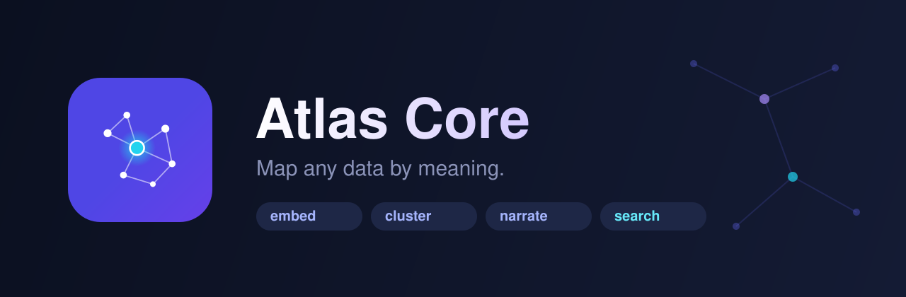

<p align="center">
  
</p>

<h1 align="center">Atlas Core</h1>

<p align="center">
  <b>Turn any pile of content into a living, searchable map of meaning.</b><br>
  Ingest → embed → cluster into topics → summarize → narrate → <b>search semantically</b>.
</p>

<p align="center">
  
  
  
  
  
</p>

---

## Why Atlas Core

Every team sits on content it can't *see*: courses, help-center articles, tickets,
records, docs. The hard, reusable part of making sense of it is never the
parsing — it's the **meaning layer**: embeddings, topic discovery, narratives, and
semantic search, done multilingual and multi-tenant.

**Atlas Core is that layer, as a small, pluggable library.** Point it at your data,
get back a semantic map you can search by meaning, cluster into topics, and
describe in plain language — in any language.

> Extracted and generalized from a production code-intelligence engine, then freed
> from code: node types are free-form, so the exact same pipeline maps **courses,
> articles, or anything** — not just source files.

## ✨ What you get

- 🔎 **Semantic + hybrid search** — by meaning, with an optional lexical rerank (`hybrid=True`) when exact terms matter. Arabic, Turkish, English, mixed.
- ✂️ **Long-doc chunking** — split long content into overlapping passages so buried points stay findable.
- 🗂️ **Automatic topic discovery** — k-means over embeddings (mini-batch at scale), auto-labeled clusters.
- 📝 **Summaries & narratives** — one-line per item + a prose overview of the whole map.
- 🔌 **Pluggable everything** — embeddings/LLM (Local · Bedrock · OpenAI · your own) and storage (in-memory · Postgres+pgvector).
- 🌍 **Multilingual & multi-tenant** — first-class Arabic & Turkish (Turkish-safe casefolding); isolate many workspaces in one store.
- 🔁 **Live incremental sync** — `atlas.sync()` re-embeds only what changed (content-hashed), reuses unchanged, and prunes deletes — the body of a scheduled update job.
- 🧭 **Two-level scoping** — one index, searchable per sub-tenant (`group`, e.g. per-academy) or globally.
- 🪶 **Runs offline, zero cloud** — clone, `pip install`, run. Scale up to pgvector when ready.

## 🚀 Quickstart

```bash
pip install -e .            # core — runs offline, no cloud
# or:  pip install -e ".[local]"   # add multilingual sentence-transformers (best offline quality)
```

```python
from atlas_core import Atlas
from atlas_core.ingest.documents import DocumentIngester
from atlas_core.providers.local import LocalEmbeddingProvider, NullLLM

docs = [
    {"id": "a1", "kind": "article", "title": "إصدار الشهادات",
     "text": "كيفية منح شهادة إتمام الدورة للطالب."},
    {"id": "a2", "kind": "article", "title": "الربط مع بوابة دفع Stripe",
     "text": "إعداد بوابة الدفع لاستقبال المدفوعات."},
    # … your content …
]

atlas = Atlas(embedder=LocalEmbeddingProvider(), llm=NullLLM())
ing = DocumentIngester(docs)
atlas.ingest(ing.nodes(), ing.links())
atlas.build()                                   # embed + cluster + summarize + narrate

atlas.search("كيف أعطي الطالب شهادة؟")           # → ranked results, by meaning
atlas.topics()                                  # → discovered topics
print(atlas.narrative.text)                     # → plain-language overview
```

`python examples/quickstart.py` to see it run.

## 📈 On real data (production providers)

```python
from atlas_core import Atlas
from atlas_core.providers.bedrock import BedrockEmbeddingProvider, BedrockLLMProvider
from atlas_core.store.postgres import PgVectorStore

emb   = BedrockEmbeddingProvider(region="us-east-1")              # Titan v2 · 1024-dim
store = PgVectorStore(dsn="postgresql://…", dim=emb.dim, tenant="my_workspace")
atlas = Atlas(embedder=emb, store=store, llm=BedrockLLMProvider(region="us-east-1"))
```

> Illustrative internal run over an ~89-article Arabic help center: topic clustering
> landed clean groups (payments, certificates, DNS, integrations …) and `"ربط بوابة دفع
> واستلام الأرباح"` returned the payout + Stripe + payment-gateway articles as top hits,
> with **zero** manual tagging. Run `examples/quickstart.py` for a small, reproducible version.

## 🧱 Architecture

```
ingest/     your domain → Node + Link        ← the only domain-specific seam
providers/  EmbeddingProvider · LLMProvider  ← local | bedrock | openai | yours
store/      VectorStore                      ← in-memory | postgres + pgvector
engine/     embed · cluster · summarize · narrate · search
models.py   Node · Link · Topic · Narrative  ← free-form kinds (not code-only)
```

| Provider | Embeddings | LLM | Install |
|---|---|---|---|
| **Local** (offline) | hashed / sentence-transformers | heuristic | `[local]` |
| **Bedrock** | Titan v2 | Claude | `[bedrock]` |
| **OpenAI** | text-embedding-3 | GPT-4o-mini | `[openai]` |
| _your own_ | implement 1 method | implement 1 method | — |

## 🧩 The one thing you write: an ingester

An ingester turns *your* world into `Node`s (+ optional `Link`s). `kind` and
`Link.type` are free-form strings. For data (not code), **derive links
deterministically from your own relations** — a lesson's `module_id` → a
`lesson_in_module` link — don't infer what your database already knows.
`DocumentIngester` covers the common case; subclass `ingest.base.Ingester` for the rest.

### Straight from a relational database — `SqlIngester`

Your structure is already in your schema, so don't infer it: **rows become nodes,
foreign keys become links.** Point it at any DB-API 2.0 connection with a small mapping:

```python
from atlas_core.ingest.sqldb import SqlIngester

ing = SqlIngester(conn, tables={
    "courses": {"kind": "course", "id": "id", "name": "title",
                "text": ["title", "description"], "group": "academy_id"},  # group → sub-tenant scope
    "lessons": {"kind": "lesson", "id": "id", "name": "title", "text": ["title", "body"]},
}, links=[
    {"from": "lessons", "fk": "course_id", "to": "courses", "type": "lesson_in_course"},
])
atlas.sync(ing.nodes(), ing.links())      # first run embeds; re-runs embed only what changed
```

See `examples/sqldb_demo.py` for the rows→nodes / FKs→links pattern end-to-end, and
`deploy/` for packaging a sync as a scheduled Lambda (EventBridge → container image).

## 🔗 Use it from an agent (+ a domain glossary)

Expose the map to any LangChain / LangGraph agent as a search tool:

```python
from atlas_core.integrations.langchain import atlas_search_tool   # pip install "atlas-core[langchain]"
tool = atlas_search_tool(atlas, kind="course")   # drop into your agent's tool list
```

Teach it your business vocabulary — map terms (+ aliases) to nodes, and let a query
be enriched before it is embedded:

```python
from atlas_core import Glossary
g = Glossary()
g.add("شهادة", node_ids=["c1"], aliases=["certificate"], definition="وثيقة إتمام الدورة")
atlas.search("how do I issue a certificate?", expand=g)   # query → + Arabic canonical + definition
```

For long content and exact-term queries:

```python
from atlas_core.ingest.documents import DocumentIngester
ing = DocumentIngester(docs, chunk_chars=1500)     # long docs → overlapping chunk nodes
atlas.search("invoice VAT", hybrid=True)           # blend vector similarity + lexical rerank
```

## 💡 Use cases

Help-center & knowledge-base search · course/LMS content maps · support-ticket
clustering · product-catalog semantic search · internal-docs discovery · the
retrieval+topic layer under a RAG or agent stack.

## 🗺️ Roadmap

- ✅ Incremental re-index (embed only what changed) — `atlas.sync()`
- ✅ Reference ingester for relational data — `SqlIngester` (+ SQLite demo)
- ✅ Scheduled cloud sync recipe (EventBridge → Lambda) — `deploy/`
- ✅ Glossary: business-term ↔ node mapping — `Glossary`
- ✅ LangChain tool adapter — `atlas_core.integrations.langchain`
- ✅ Long-document chunking — `chunk_text` / `DocumentIngester(chunk_chars=…)`
- ✅ Hybrid retrieval (vector + lexical rerank) — `search(hybrid=True)`
- Learned re-ranking (cross-encoder) + BM25 / full-text fusion
- Reproducible retrieval benchmark harness

## License

Apache-2.0 © 2026 — contributions welcome once public.
